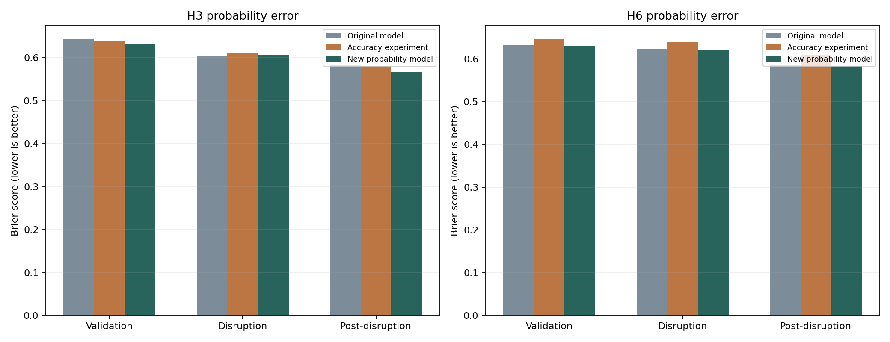
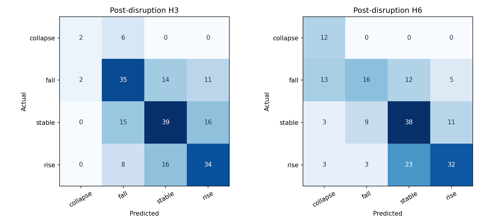
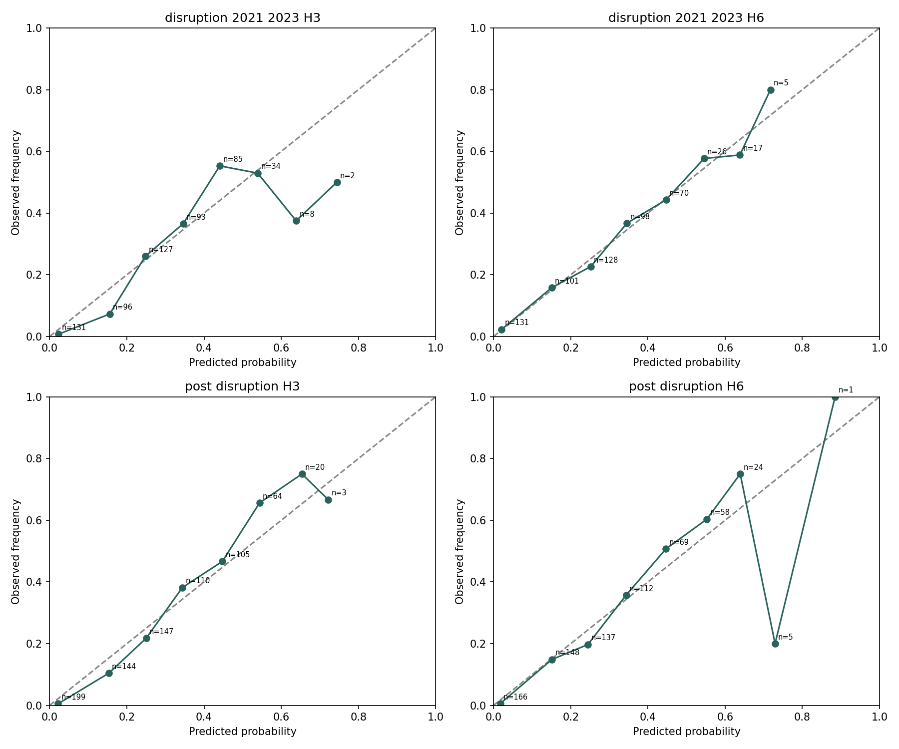

# Titanium Model B: Supplier-Share Movement Probabilities

Updated 13 October 2026 from the saved calibrated-V2 code, data, selections and evaluation files. No fitting, thresholds or selected models were changed.

## Summary And Readiness

Model B predicts whether each main supplier's share of UK titanium imports by weight will **collapse, fall, remain stable or rise**, at **H3 and H6**. It returns four probabilities adding to one and the most probable class. It is supervised multiclass classification, not an exact import-volume forecast.

This package beats both required Brier baselines in all six saved validation/test groups. However, calibration fails for **H3 disruption and H3/H6 post-disruption**. Exact class accuracy is approximately **46-56%**, not 80%. It is useful for a clearly caveated research/demo comparison, but not a fully calibrated production risk signal.

H12 labels remain in the upstream dataset for provenance; **this calibrated package does not train or serve H12**.

## Data And Sources

| Item | Description |
| --- | --- |
| Main input | [titanium_model_b_country_month_training_2010_2026.csv](data/titanium_model_b_country_month_training_2010_2026.csv) |
| Frequency / coverage | Monthly, January 2010-June 2026 |
| Shape | 1,188 rows, 75 columns; 198 months x six supplier groups |
| Supplier groups | USA, Japan, France, Russian Federation, China and Other countries |
| Product scope | Combined HS 810820 and 810890; HS 810830 waste/scrap excluded |
| Trade | [UN Comtrade](https://comtradeplus.un.org/): UK import weight, value and prepared supplier shares |
| Currency | [Bank of England Database](https://www.bankofengland.co.uk/boeapps/database/): exchange-rate conversion and FX movement |
| Broad price proxy | [ONS price statistics](https://www.ons.gov.uk/economy/inflationandpriceindices): ERUC/PPI |
| Not included | Required aluminium/nickel benchmark changes remain absent under the earlier source restriction; no fabricated benchmark series were added |

Country quantities were **reconstructed from prepared HS supplier shares multiplied by HS net weights**, then summed across the two HS codes. Country share is country quantity divided by total quantity. Monthly country shares sum to one. Reconciliation to the enriched upstream file is not independent validation against original raw partner downloads.

[Fixed thresholds](data/model_b_fixed_class_thresholds.json), [source audit](results/source_audit.json) and [upstream reconstruction input](data/upstream_titanium_model_a_training_with_fx_eruc_2010_2026.csv) preserve provenance. The upstream file is used for reconciliation, not passed as an additional predictor matrix. Full raw download-to-panel regeneration is not bundled.

## Preparation And Target Labels

The original CSV is retained unchanged. The local loader parses dates, computes extra features separately within each supplier's historical sequence, checks unique country-month keys, verifies shares and aligns targets. Missing feature values are handled by fitted preprocessing; future missing labels are excluded from training.

For horizon h:

**share_change[t,h] = country_share[t+h] - country_share[t]**

The actual class is derived from this future observed share change; the predicted class is the largest model probability. It is an absolute share difference, not a relative percentage change in country volume. For example, a share changing from 20% to 17% is -3 percentage points, not -3% of its initial share.

| Horizon | Fitted classification label | Supporting actual columns |
| --- | --- | --- |
| H3 | target_class_h3 | target_country_share_h3, target_share_change_h3, target_month_h3 |
| H6 | target_class_h6 | target_country_share_h6, target_share_change_h6, target_month_h6 |

The future labels are supervised ground truth, never estimator inputs. H3/H6 models are direct-horizon classifiers, not recursive monthly predictions.

### Fixed Class Boundaries

Boundaries were derived from pooled pre-test H3 share changes from available 2010-June 2021 history, then frozen. The requested 2005-2009 history is missing. The threshold file records 810 usable changes; these are not 810 distinct months.

| Class | Boundary in share-fraction units | Approximate percentage-point interpretation |
| --- | --- | --- |
| Collapse | change < -0.1446075178264113 | A fall larger than 14.4608 percentage points |
| Fall | -0.1446075178264113 <= change < -0.022944922950439307 | Fall between about 14.46 and 2.29 percentage points |
| Stable | -0.022944922950439307 <= change <= 0.02088710731068383 | Change from about -2.2945 to +2.0887 percentage points |
| Rise | change > 0.02088710731068383 | Increase larger than 2.0887 percentage points |

A country with less than 14.46% current share cannot lose over 14.46 percentage points. The selected feasibility rule therefore gives some collapse probabilities exactly zero. This follows share bounds; it is not a missing prediction. It also makes the definition hard to use as a generic collapse detector for small-share countries.

## Features And How Models Learn

H3 uses **66 expanded inputs**; H6 uses **35 core inputs**. The full exact lists are in [results/model_manifest.json](results/model_manifest.json). The feature engine adds derived fields in memory; they need not all exist as columns in the original CSV.

| Core inputs | Meaning |
| --- | --- |
| country_share; log1p_country_quantity_kg | Current share and transformed supply scale |
| country_share_change_1m, _3m, _6m, _12m | Historical absolute share movement |
| country_quantity_log1p_change_1m, _3m, _6m, _12m | Historical transformed country-volume movement |
| total_import_log_change_1m, _3m, _6m, _12m | Total UK titanium volume movements |
| titanium_price_log_change_1m, _3m, _6m, _12m | Historical titanium import-price changes, not a live call to Model A |
| fx_log_change_1m, _3m, _6m, _12m | Exchange-rate movements |
| eruc_log_change_1m, _3m, _6m, _12m | Broad non-ferrous import-price movements |
| supplier_hhi_weight; top_supplier_share_weight; partner_count_total | Market concentration and diversification |
| month_sin; month_cos | Calendar seasonality |
| eu_collection_change_flag; weight_reconstructed_any_flag; world_weight_estimated_any_flag | Collection and data-quality controls |
| country_key | Supplier identity; one-hot encoded, not treated as a numeric country ranking |

Suffix abbreviations share the displayed prefix. These 35 fields are the H6 input set.

| Additional expanded inputs | Derivation / role |
| --- | --- |
| country_share_lag_1m, _3m, _6m, _12m | Share at those earlier months, not an average |
| year_trend | Elapsed months since January 2010 |
| country_share_rank; country_share_relative_to_top; country_share_gap_to_top; is_top_supplier | Current share rank, ratio/gap to the top share and dominance flag |
| share_velocity_1m, _3m, _6m | Historical share changes normalized per month |
| share_acceleration_1m_vs_3m, _3m_vs_6m, _6m_vs_12m | Differences between short- and longer-term velocities |
| quantity_velocity_1m, _3m; quantity_acceleration_1m_vs_3m | Country-volume velocity and acceleration |
| country_share_rolling_mean_3m, _6m, _12m | Recent mean share |
| country_share_rolling_std_3m, _6m, _12m | Population standard deviation of recent shares |
| country_share_vs_rolling_mean_3m, _6m, _12m | Current share minus its recent mean |
| country_share_rolling_range_3m, _6m, _12m | Recent maximum minus minimum share |
| last_observed_3m_class | Class of the already-observed historical 3-month change, not the future target |

Rolling features include the current observed month and use available historical windows with at least two observations. Derived features are deterministic calculations, not random synthetic values. Timing flags are explicit assumptions/eligibility controls rather than model targets.

Forest trees learn conditional splits in historical features; leaf class frequencies produce probabilities. H3 averages Random Forest and Extra Trees probabilities. Temperature scaling changes their sharpness, and the share-bound rule masks impossible classes before renormalizing. Historical-frequency blending was tested but selected weight is zero. Preprocessing fits numeric imputation and categorical encoding using each fitting fold's training rows.

## Chronological Split And Calibration

| Stage | Origins / outcomes | Interpretation |
| --- | --- | --- |
| Initial history | 2010 onward; initial validation fits use eligible pre-2018 history | Lag completeness and assumed outcome availability restrict fitting rows |
| Validation blocks | 2018, 2019, January 2020-June 2021 | Outcomes must target June 2021 or earlier |
| Actual validation origins | H3: January 2018-March 2021; H6: January 2018-December 2020 | 234 and 216 supplier-month predictions respectively |
| Disruption test | Origins July 2021-June 2023 | 24 origins x six suppliers = 144 predictions per horizon |
| Post-disruption | Origins July 2023 onward | H3 ends March 2026 (198 rows); H6 ends December 2025 (180 rows) |
| Latest inference | June 2026 origin | Six suppliers x two horizons = 12 forecasts |

H3 disruption targets run October 2021-September 2023; H6 targets January 2022-December 2023. Post targets end June 2026. These are origin-based tests, not a requirement that every target month lies inside the named period.

Fits expand monthly during testing and use only prior targets assumed available at that origin. Settings are selected using validation, not test rankings, and then frozen. Earlier experiments already inspected the historical test periods, so these are reused evaluations rather than a new untouched holdout.

FX availability is assumed at month-end +7 days; PPI at month-end +31 days; trade timing is inherited. Historical publication dates and revision vintages are unverified. Class thresholds and probability calibration settings are selected using pre-test history, but validation calibration results are not a separate untouched probability-calibration test.

## Algorithms Compared And Selected

The experiment compared seven classifiers: core Random Forest, core Extra Trees, core Logistic Regression, supplier-history Extra Trees, expanded Random Forest, expanded Extra Trees and core HistGradientBoosting. It also compared original-core and expanded forest ensembles.

For each candidate it tested temperatures 0.75/1.0/1.25/1.5/2.0, historical-frequency blend weights 0/0.15/0.3/0.5 and share feasibility on/off. Selection prefers configurations beating both Brier baselines and having maximum calibration gap <=0.10, then minimizes validation Brier, with ECE/log-loss tie breakers. [All configurations](results/validation_configuration_comparison.csv).

| Horizon | Selected model | Inputs | Probability settings | Saved artifact |
| --- | --- | ---: | --- | --- |
| H3 | Expanded Random Forest + Extra Trees ensemble | 66 | Temperature 1.25, frequency blend 0, feasibility enabled | [model_b_h3_calibrated.joblib](models/model_b_h3_calibrated.joblib) |
| H6 | Core Extra Trees classifier | 35 | Temperature 0.75, frequency blend 0, feasibility enabled | [model_b_h6_calibrated.joblib](models/model_b_h6_calibrated.joblib) |

Selection is not a claim that these algorithms are universally best. Each bundle includes preprocessing, estimators, fixed thresholds, configuration and historical frequencies.

## Metrics And Acceptance

| Metric | Interpretation |
| --- | --- |
| Accuracy | Fraction where the largest-probability class equals actual_class |
| Balanced accuracy | Mean recall across classes; reduces dominance of common classes |
| Macro F1 | Mean class F1; balances precision/recall without weighting by class frequency |
| Multiclass Brier | Mean sum of four squared probability errors; lower is better, range 0-2 under this implementation, not divided by four |
| Log loss | Penalizes low probability assigned to the actual class |
| Expected calibration error (ECE) | Count-weighted average probability-versus-frequency gap |
| Maximum calibration gap | Worst occupied bin gap; a sparse bin can fail despite small average ECE |
| Brier skill versus frequency | 1 - model Brier / historical-frequency Brier; above zero is better |

Baselines are **last-observed-change class** (one-hot persistence probabilities) and **supplier historical class-frequency probabilities** fitted to eligible history. They are not random predictions.

Reliability flattens the four class probabilities and binary actual indicators into ten probability bins. Empty bins have no observed frequency; occupied sparse bins remain in the test. The saved acceptance rule requires beating both Brier baselines and maximum occupied-bin gap <=0.10. It does **not** require 80% accuracy.

### Main Performance Table

| Period | H | Rows | Accuracy | Balanced accuracy | Macro F1 | Brier | Frequency baseline | Persistence baseline | Max gap | Result |
| --- | --- | ---: | ---: | ---: | ---: | ---: | ---: | ---: | ---: | --- |
| Validation | H3 | 234 | 48.72% | 40.32% | 0.4063 | 0.6323 | 0.7100 | 1.5299 | 0.0901 | Pass |
| Validation | H6 | 216 | 45.83% | 46.09% | 0.4548 | 0.6300 | 0.7005 | 1.4537 | 0.0553 | Pass |
| Disruption | H3 | 144 | 52.78% | 51.09% | 0.5322 | 0.6064 | 0.6539 | 1.4306 | 0.2636 | Fail calibration |
| Disruption | H6 | 144 | 47.22% | 53.26% | 0.4793 | 0.6218 | 0.6900 | 1.4028 | 0.0826 | Pass |
| Post | H3 | 198 | 55.56% | 48.95% | 0.5054 | 0.5666 | 0.6528 | 1.4545 | 0.1124 | Fail calibration |
| Post | H6 | 180 | 54.44% | 62.38% | 0.5362 | 0.5827 | 0.6766 | 1.4556 | 0.5294 | Fail calibration |

Source: [evaluation_metrics.csv](results/evaluation_metrics.csv).

| Period | H | ECE | Log loss |
| --- | --- | ---: | ---: |
| Validation | H3 | 0.0199 | 1.0832 |
| Validation | H6 | 0.0265 | 1.0892 |
| Disruption | H3 | 0.0448 | 1.0274 |
| Disruption | H6 | 0.0151 | 1.0727 |
| Post | H3 | 0.0387 | 0.9663 |
| Post | H6 | 0.0318 | 1.0058 |

### Comparison With Earlier Models

| Period / H | Original Brier | Earlier accuracy experiment | Current calibrated V2 | Interpretation |
| --- | ---: | ---: | ---: | --- |
| Validation H3 | 0.6428 | 0.6377 | 0.6323 | Improved Brier |
| Validation H6 | 0.6316 | 0.6457 | 0.6300 | Slight improvement |
| Disruption H3 | 0.6025 | 0.6103 | 0.6064 | Worse than original, better than accuracy experiment |
| Disruption H6 | 0.6237 | 0.6394 | 0.6218 | Slight improvement |
| Post H3 | 0.5835 | 0.5816 | 0.5666 | About 2.9% lower Brier than original, but calibration still fails |
| Post H6 | 0.5851 | 0.6090 | 0.5827 | Slight improvement, calibration still fails |

Source: [previous_vs_new_metrics.csv](results/previous_vs_new_metrics.csv). Better probability error is not necessarily better accuracy: post H3 accuracy is about 0.51 percentage points lower than the original model. H6 accuracy is unchanged from the original in these saved periods.

**Practical interpretation:** these probabilities contain more information than the baselines, but about half the most-likely classes are incorrect. This is not an 80%-accurate supplier forecast. A calibration failure means a stated probability and the observed frequency differ too much in at least one bin, not that every prediction is wrong. Post H6's worst bin contains only five class-probability observations; it still counts as failure. Post H3's failing bin has 64 observations. [Reliability bins](results/reliability_bins.csv).

## Ground Truth And Forecast Outputs

[all_ground_truth_predictions.csv](results/all_ground_truth_predictions.csv) contains validation and both tests. Compare **actual_class** with **predicted_class**; **correct** is their equality. actual_future_share and actual_share_change explain the derived actual label. Confidence is the maximum model probability, **not verified case-level accuracy** or an independent probability that the selected class is correct.

[Latest forecasts](results/latest_forecasts.csv) and [response JSON](results/model_b_response.json) use June 2026 as the origin. H3 targets September 2026; H6 targets December 2026. The computer date does not update this observation cutoff.

Examples; probabilities are shown as percentages rounded independently:

| Supplier | H | Collapse | Fall | Stable | Rise | Most likely |
| --- | --- | ---: | ---: | ---: | ---: | --- |
| Japan | H3 | 1.52% | 17.23% | 10.16% | 71.09% | Rise |
| Russian Federation | H3 | 0.00% | 12.96% | 64.46% | 22.58% | Stable |
| USA | H6 | 54.81% | 19.38% | 11.82% | 13.99% | Collapse |

The full-precision four probabilities sum to one; displayed rounded percentages can differ slightly from 100%. The response includes country, current share, horizon, origin/target month, algorithm, class and confidence. It does not predict an exact future country share or volume.

## Graphs And Detailed Diagnostics

[Russia risk check](visualizations/russia_risk_check.png) | [Interactive dashboard](visualizations/model_b_probability_improvement_dashboard.html) | [Supplier-level metrics](results/country_metrics.csv) | [Class recalls](results/class_recall.csv).

GitHub renders images; download/open the HTML locally for interactive filters. No learned feature-importance chart is claimed for this selected ensemble merely because a previous experiment has one.

## Package Map And Run Commands

| Location | Contents |
| --- | --- |
| data/ | Original training panel, fixed thresholds, feature/selection manifests and reconciliation/comparison inputs |
| code/ | Training/inference, local feature engine and verification scripts |
| models/ | Selected H3/H6 calibrated bundles |
| results/ | Actual/predicted records, metrics, reliability, selection, source audit and latest outputs |
| visualizations/ | PNG charts and standalone HTML dashboard |

Run from this calibrated V2 folder:

    python -m pip install -r requirements.txt
    python code/verify_local_data.py
    python code/train_probability_model_b.py --predict-only

Verification checks the source hash, fixed thresholds and **48 latest probability values**. Predict-only regenerates the latest CSV/JSON, not historical evaluation. The entry point uses local data/ and code/model_b_feature_engine.py, not required parent-folder inputs. The helper feature-engine file is a dependency, not the selected training entry point.

Running train_probability_model_b.py without flags performs training and writes results; preserve the current evidence or use a new experiment folder. The original model source directory was not changed during packaging. Load only trusted joblib files.

## Outstanding Requirements And Next Work

Model B still has missing 2005-2009 history, UN Comtrade rather than requested HMRC inputs, absent required aluminium/nickel changes, and hardcoded supplier membership requiring raw-partner verification against the 2018-2020 >=5% selection rule. It reconciles prepared weights, not raw imports. No Russia H3/H6 disruption observation has a collapse target under the frozen boundaries, so the intended Russia-collapse demonstration is unresolved.

Improve calibration with an untouched chronological calibration/holdout study, examine sparse-bin and class/supplier reliability, verify source vintages and partner aggregation, and seek additional genuine predictors rather than manufacturing missing history. Retain the fixed thresholds for fair comparisons. Do not merge bins or select test winners merely to obtain a pass.

B's Brier/classification accuracy cannot be directly compared with A/C regression errors. See the root [source/reuse review](../../../DATA_SOURCES_AND_REUSE.md) before public data sharing. The package is technically verified for saved-model inference, not production-approved; clean-environment installation remains untested.
