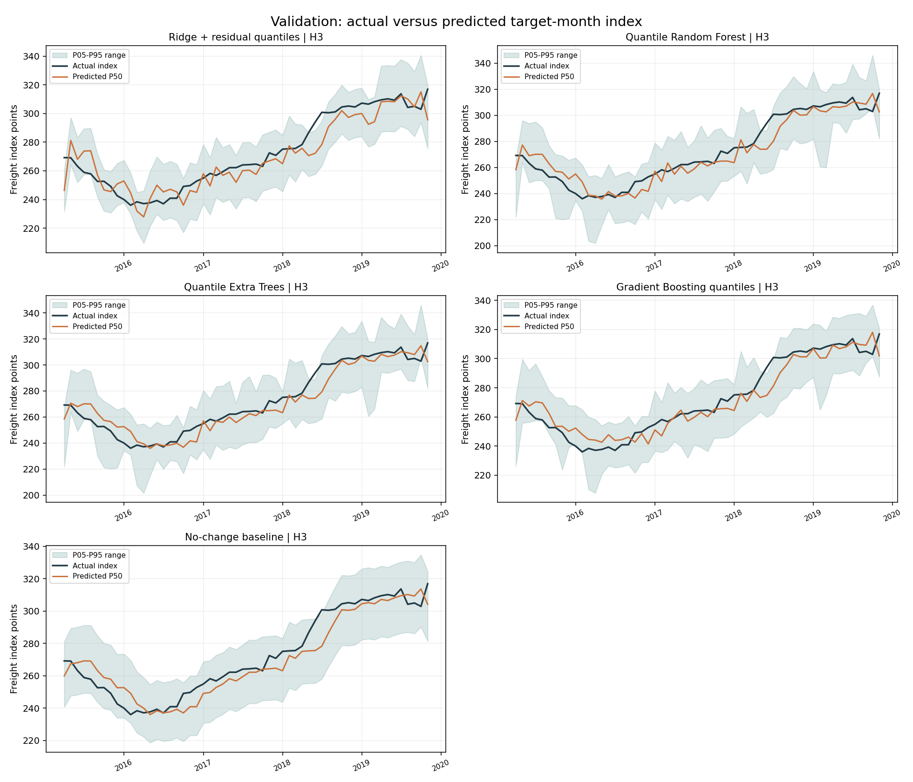
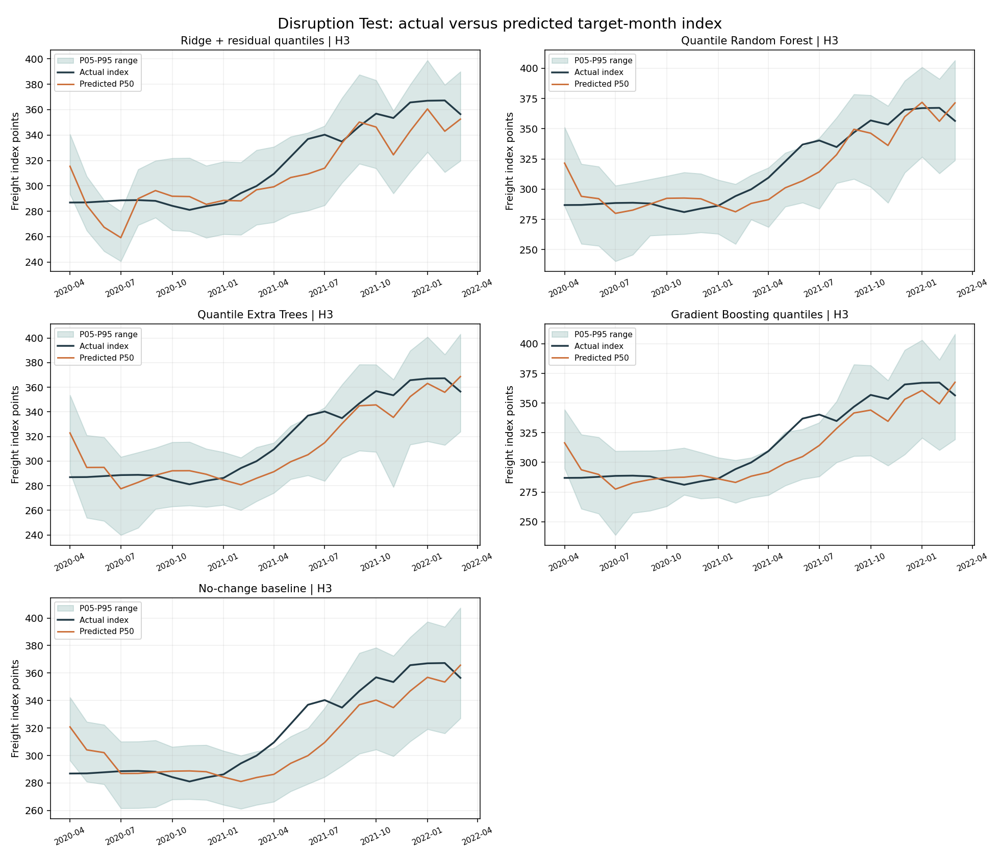
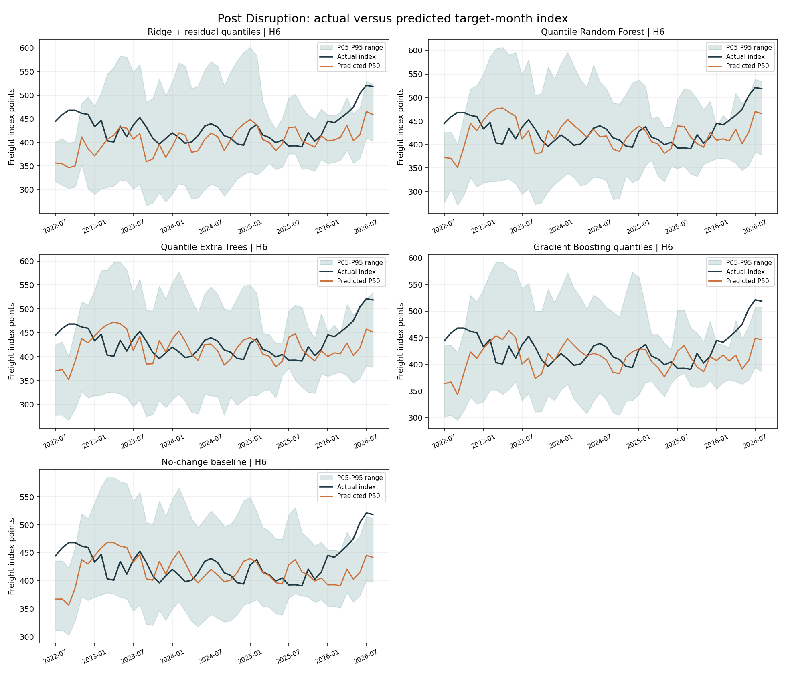
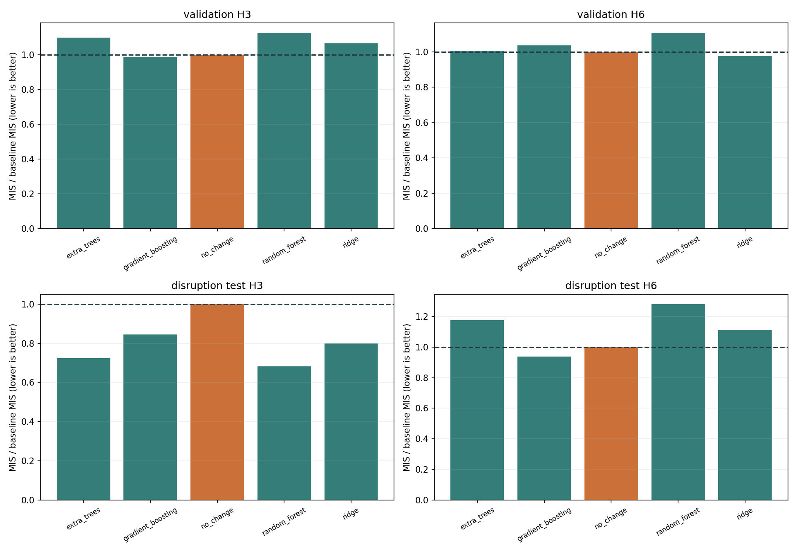
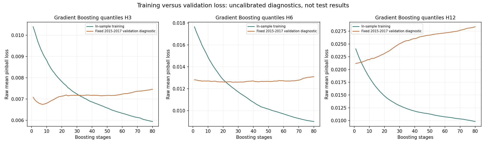
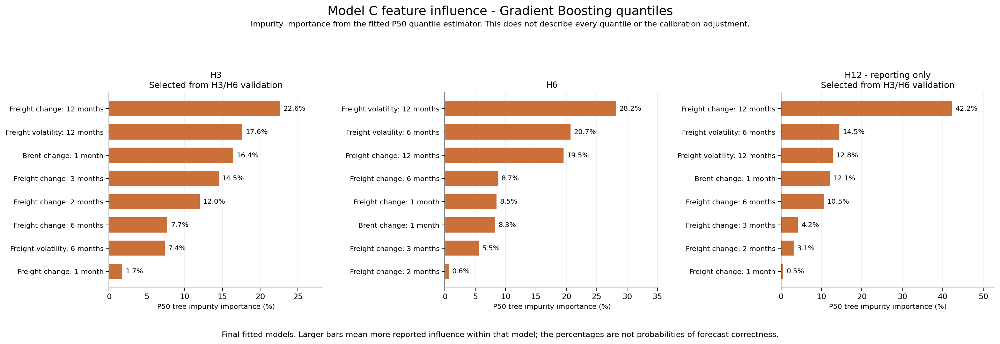

# Titanium Model C: Freight-Cost Movement Forecasts

Updated 13 October 2026 from the saved training_v1 data, code, selection records and evaluation outputs. Documentation only; no models were retrained or promoted.

## Summary And Readiness

Model C predicts **future log changes in a deep-sea freight producer-price index**, with seven quantiles at H3/H6 and additional **H12 reporting-only**. It converts these changes into percentage movement and an index level for interpretation. This is supervised direct-horizon probabilistic regression, not a recursive/unsupervised forecast.

The saved default is **Gradient Boosting H3**, **no-change baseline H6**, and **Gradient Boosting H12**. Random Forest is the strongest retrospective H3 disruption comparator, but it failed the validation baseline comparison; it is not the pre-test-selected default.

Results are mixed: H3 median MAPE is about **3.70% during disruption**, but the selected model's interval coverage is only **87.50%**, below the 90% requirement. H6 remains a fallback and H12 disruption coverage is **25%**. This is a research/demo with visible limitations, not production acceptance.

## Data, Sources And Meaning

| Item | Prepared dataset used here |
| --- | --- |
| Input | [model_c_freight_training_2005_2026.csv](data/model_c_freight_training_2005_2026.csv) |
| Frequency / coverage | Monthly, January 2005-August 2026 |
| Size | 260 reference months; 67 columns, of which eight are estimator features |
| Freight source | US Bureau of Labor Statistics deep-sea freight producer-price index, obtained from [FRED PCU483111483111](https://fred.stlouisfed.org/series/PCU483111483111) |
| Fuel signal | Brent crude-oil monthly USD/barrel price from [World Bank Commodity Price Data / Pink Sheet](https://www.worldbank.org/en/research/commodity-markets) |
| Metadata | [Preparation manifest](data/model_c_preparation_manifest.json), [column dictionary](data/model_c_training_column_dictionary.csv) |

The freight index measures price movements relative to its reference base, not an absolute freight quote in GBP, USD or GBP/kg. Brent is a direct oil price used to construct a historical fuel-cost signal. **The model does not predict Brent prices**, and it is not trained on titanium import values. Its relationship to titanium is as a broad freight-cost proxy, not a titanium-specific route tariff.

The source files have longer history; 2004 is used for feature warmup, but labelled/exported rows start in 2005. The prepared snapshot ends in August 2026 where both inputs are aligned. The raw source CSV/workbook remain in the sibling Model C Data directory for provenance; inference/training read local data/ and do not require those raw files.

## Preparation And Targets

Inputs are aligned monthly, historical changes and volatility are computed, calendar/timing evidence is retained, and future observed freight values are shifted to origin rows as supervised labels. Early warmup is separated from exported training history. Final not-yet-observed targets remain blank; they are not filled with predictions or fabricated actuals.

| Quantity | Formula |
| --- | --- |
| Historical change over k months | ln(freight_index[t] / freight_index[t-k]) |
| Fitted future target at h | ln(freight_index[t+h] / freight_index[t]) |
| Predicted percentage movement | 100 * (exp(predicted_log_change) - 1) |
| Predicted index level | freight_index[t] * exp(predicted_log_change) |

t-12 means the **single observation twelve months earlier**, not the sum/mean of the preceding twelve values. H3 means the target month three months ahead, not an average of the next three months.

| Horizon | Fitted target | Supporting observed outcome |
| --- | --- | --- |
| H3 | target_freight_log_change_h3 | target_freight_index_h3, target_freight_pct_change_h3, target_month_h3 |
| H6 | target_freight_log_change_h6 | target_freight_index_h6, target_freight_pct_change_h6, target_month_h6 |
| H12 | target_freight_log_change_h12 | target_freight_index_h12, target_freight_pct_change_h12, target_month_h12 |

Labels are calculated from genuine later observations for historical supervised training. They are never predictor inputs. Timing/eligibility fields control available labels; assigned assumed-release flags are not random synthetic market data and are not estimator features.

## Eight Features Used

Exact feature list: [results/run_manifest.json](results/run_manifest.json).

| Input feature | Calculation / role |
| --- | --- |
| freight_log_change_1m | Current versus previous-month log change; recent movement |
| freight_log_change_2m | Current versus two-month-earlier log change |
| freight_log_change_3m | Current versus three-month-earlier log change |
| freight_log_change_6m | Current versus six-month-earlier log change |
| freight_log_change_12m | Current versus twelve-month-earlier log change; annual movement |
| freight_volatility_6m | Population standard deviation of latest six monthly freight log returns |
| freight_volatility_12m | Population standard deviation of latest twelve monthly freight log returns |
| brent_log_change_1m | ln(Brent[t] / Brent[t-1]); historical oil/fuel-cost movement |

Volatility includes the current observed month, uses ddof=0 and is not annualized. Only these eight inputs enter the fitted regressors. Freight/Brent availability dates, target dates, future targets, split labels and verification flags do not.

Feature importance is not causal evidence. Ridge coefficients, tree impurity importance and Gradient Boosting P50 importance are different diagnostic measures. The no-change baseline has no learned feature mapping and no learned feature importance.

## Train, Validation And Test Split

This is an expanding chronological evaluation, not a random split. Settings were fixed before the disruption evaluation. Each historical fit uses only past outcomes assumed available at its issue date. Later fits may include earlier test outcomes after publication; this simulates ongoing refitting rather than one frozen 2019 estimator throughout testing.

| Stage | Reference origins | Actual evaluated size / purpose |
| --- | --- | --- |
| Initial history | January 2005-December 2014 | 120 reference months; eligible fit counts differ by horizon/timing |
| Main validation | 2015-2019 | 56 H3, 53 H6 and 47 H12 eligible outcomes known before 1 January 2020 |
| Eligible validation origins | H3 ends August 2019; H6 May 2019; H12 November 2018 | Late origins cannot enter selection before their targets are known |
| Pretest bridge | Late 2019 origins, horizon-dependent | Excluded from selection; completed predictions can support later recovery diagnostics |
| Primary disruption test | January 2020-December 2021 reference months | 24 forecasts per model/horizon; COVID-era freight disruption |
| Separate issue-date test | Assumed forecast issue dates in January 2020-December 2021 | Also 24 per model/horizon, but boundary reference months differ; not interchangeable with the primary table |
| Post-disruption monitoring | January 2022 onward | H3 ends May 2026 (53); H6 February 2026 (50); H12 August 2025 (44) |
| Latest saved origin | August 2026 | Assumed issue date 30 September 2026 |

The primary test labels **origins**, not outcomes. H3 disruption targets extend through March 2022, H6 through June 2022 and H12 through December 2022. Post targets end August 2026.

The user chose initial history 2005-2014 and validation 2015-2019. The broader specification's 2012-2019 validation was not fully implemented: 2012-2014 remain initial training, not a separate early backtest.

### Calibration And Timing

The latest **24 eligible labelled origins** are held out for chronological quantile calibration. Earlier proper-training rows are additionally purged so their targets were available at the first calibration origin's assumed issue date. Both model and baseline use the same holdout/purge protocol but their own errors.

Held-out P05/P95 miss scores determine a nonnegative conformal expansion. Intermediate quantiles shift proportionally around P50; the median remains unchanged and outputs remain ordered. Overlapping outcomes and nonstationary time series do not satisfy a simple exchangeability guarantee, so nominal 90% coverage is tested, not promised.

Source observations are assumed usable at the end of the following month. Actual historical release dates and revision vintages are unverified; the preparation manifest records zero strictly point-in-time verified rows.

## Models Compared And Saved Default

| Algorithm | Learning and quantile distribution |
| --- | --- |
| Ridge + residual quantiles | Standardized linear regression plus empirical training-residual quantiles |
| Quantile Random Forest | Trees fitted to log changes; quantiles from historical target values in reached leaves, equal total weight per tree |
| Quantile Extra Trees | More randomized splits with the same leaf-distribution quantile method |
| Gradient Boosting quantiles | Separate quantile-loss regressor for each of seven probabilities |
| No-change baseline | Median future log change zero; historical no-change errors provide uncertainty |

There are **15 saved bundles**: five approaches x three horizons. A Gradient Boosting bundle contains seven quantile estimators; it is not one multi-output estimator. H6/H12 predict their own labelled horizons, not recursive H3 outputs.

| Horizon | Saved default | Selection reason / artifact |
| --- | --- | --- |
| H3 | Gradient Boosting | Passed validation coverage/MIS gates; [model_c_h3.joblib](models/gradient_boosting/model_c_h3.joblib) |
| H6 | No-change baseline | No ML candidate passed validation gates; [model_c_h6.joblib](models/no_change/model_c_h6.joblib) |
| H12 | Gradient Boosting | Family selected from H3/H6 comparison only; reporting-only; [model_c_h12.joblib](models/gradient_boosting/model_c_h12.joblib) |
| H3 comparator | Random Forest | Stronger historical disruption result, not promoted after testing; [model_c_h3.joblib](models/random_forest/model_c_h3.joblib) |

[Selection record](results/selected_models.json). H3/H6 selection prefers coverage >=90%, no missing forecasts and MIS better than baseline; otherwise it retains the baseline and reports the best ML candidate. Ridge has the lowest H6 ML validation MIS, but fails coverage. H12 scores are excluded from choosing the model family.

## Evaluation Metrics And Recovery

| Metric | Meaning |
| --- | --- |
| MAE / RMSE in index points | Absolute / squared-error-sensitive median index error |
| MAPE / sMAPE | Percentage deviation of median index forecast; not classification accuracy |
| MAE/RMSE log change | Error on the actual fitted target scale |
| Pinball loss | Mean quantile loss over all seven outputs |
| P05-P95 coverage | Fraction inside the nominal 90% interval |
| MIS / baseline | Width and miss penalties at alpha 0.10, in log-change units; below 1 is better |
| Recovery | Six completed, assumed-published outcomes achieve >=90% coverage after disruption, within the implemented six-month deadline |

With only six completed observations, >=90% coverage requires **six of six** inside the interval. The recovery definition and dates are in [recovery_summary.csv](results/recovery_summary.csv); it differs from A's origin-based recovery. Probability gates require coverage and MIS superiority with no missing outputs; full disruption gates additionally require recovery. H12 is reporting-only. Baseline cannot beat its own MIS, so its acceptance flag is not a separate self-comparison failure.

### Validation Comparison: All Approaches

| Algorithm | H3 coverage | H3 MIS / baseline | H3 MAPE | H6 coverage | H6 MIS / baseline | H6 MAPE |
| --- | ---: | ---: | ---: | ---: | ---: | ---: |
| Ridge | 92.86% | 1.0647 | 2.87% | 86.79% | 0.9778 | 5.29% |
| Random Forest | 94.64% | 1.1264 | 2.36% | 94.34% | 1.1087 | 4.45% |
| Extra Trees | 92.86% | 1.0985 | 2.24% | 98.11% | 1.0076 | 4.42% |
| Gradient Boosting | 94.64% | 0.9887 | 2.32% | 88.68% | 1.0362 | 4.33% |
| No-change | 98.21% | 1.0000 | 2.39% | 100.00% | 1.0000 | 4.36% |

[Validation metrics](results/validation_metrics.csv). Gradient Boosting's H3 advantage in MIS is small, around 1.1%, not overwhelming proof of superiority.

### Primary Disruption Comparison: All Approaches

| Algorithm | H3 coverage | H3 MIS / baseline | H3 MAPE | H3 full gate | H6 coverage | H6 MIS / baseline | H6 MAPE |
| --- | ---: | ---: | ---: | --- | ---: | ---: | ---: |
| Ridge | 91.67% | 0.7997 | 3.93% | Fail recovery | 75.00% | 1.1103 | 8.56% |
| Random Forest | 95.83% | 0.6829 | 3.72% | Pass | 62.50% | 1.2802 | 7.34% |
| Extra Trees | 91.67% | 0.7247 | 3.90% | Fail recovery | 62.50% | 1.1751 | 7.49% |
| Gradient Boosting | 87.50% | 0.8450 | 3.70% | Fail coverage/recovery | 70.83% | 0.9370 | 7.31% |
| No-change | 79.17% | 1.0000 | 4.47% | Reference | 66.67% | 1.0000 | 8.38% |

Random Forest improves H3 disruption MIS by about 31.7% versus baseline, but was worse in validation. Picking it after viewing the test would reuse the test for selection. No H6 ML model reaches 90% disruption coverage.

### Selected Default: Validation, Disruption And Post-Disruption

| Period | Default / H | N | MAE index | RMSE index | MAPE | Coverage | MIS | MIS / baseline |
| --- | --- | ---: | ---: | ---: | ---: | ---: | ---: | ---: |
| Validation | Gradient Boosting H3 | 56 | 6.2810 | 7.8792 | 2.32% | 94.64% | 0.1510 | 0.9887 |
| Validation | No-change H6 | 53 | 11.7377 | 13.5448 | 4.36% | 100.00% | 0.2528 | 1.0000 |
| Validation | Gradient Boosting H12 | 47 | 26.3448 | 30.5668 | 9.45% | 80.85% | 0.4230 | 1.0835 |
| Disruption | Gradient Boosting H3 | 24 | 11.9265 | 14.7679 | 3.70% | 87.50% | 0.2438 | 0.8450 |
| Disruption | No-change H6 | 24 | 29.5177 | 36.2870 | 8.38% | 66.67% | 0.4880 | 1.0000 |
| Disruption | Gradient Boosting H12 | 24 | 68.7632 | 84.5234 | 16.68% | 25.00% | 1.5668 | 1.1148 |
| Post | Gradient Boosting H3 | 53 | 28.2190 | 33.2080 | 6.52% | 94.34% | 0.3687 | 1.0147 |
| Post | No-change H6 | 50 | 33.6923 | 43.9685 | 7.62% | 84.00% | 0.4799 | 1.0000 |
| Post | Gradient Boosting H12 | 44 | 31.7735 | 40.2212 | 7.33% | 90.91% | 0.6262 | 1.1139 |

Source: [evaluation_metrics.csv](results/evaluation_metrics.csv). H12 is not an acceptance decision. All displayed groups have complete predictions and observed targets. Separate issue-date test results are labelled separately in that file; for example selected H3 coverage is 83.33%, not the primary test's 87.50%.

**Interpretation:** selected H3 central forecasts are fairly close during disruption, but under-cover uncertainty. Post H3 coverage recovers while MIS is slightly worse than baseline, and MAPE rises to 6.52%. H6's fallback intervals under-cover both later periods. H12 is particularly weak during disruption. Plausible positive index levels and small median errors do not establish calibrated future risk.

## Ground Truth, Errors And Loss Curves

Compare **actual_freight_index** with **p50_freight_index** (also predicted_freight_index) in the saved prediction records. Compare actual_log_change with p50_log_change for fitted-target error. Origin_freight_index is the known starting point, not future actual.

Signed error = predicted - actual; absolute_pct_error = 100 * abs(predicted - actual) / actual. An average MAPE of 3.70% does not imply every month is within 3.70%, nor a guaranteed 96.30% probability of being correct.

[Validation records](predictions/validation_actual_vs_predicted.csv) | [Disruption records](predictions/disruption_test_actual_vs_predicted.csv) | [Post records](predictions/post_disruption_actual_vs_predicted.csv) | [Separate issue-date test](predictions/specification_issue_date_test_actual_vs_predicted.csv).

Training/validation diagnostics use **raw uncalibrated pinball loss**, not classification accuracy. Ridge varies chronological training size; forests vary tree count; Gradient Boosting shows staged estimates. These are not all epoch-based curves. Initial proper-training predictions are in-sample diagnostics and do not determine readiness; the diagnostic validation subset is 2015-2017. [Curve values](results/train_validation_loss_curves.csv), [in-sample metrics](results/in_sample_diagnostic_metrics.csv).

## Latest Selected Forecasts

Reference observation: **August 2026**, index **518.6170**; assumed issue date **30 September 2026**. Horizons count from the observation, not the current computer month.

| Horizon / target | Selected model | P05 index | P50 index | P95 index | P50 movement |
| --- | --- | ---: | ---: | ---: | ---: |
| H3 / November 2026 | Gradient Boosting | 478.4597 | 530.9941 | 582.8774 | +2.39% |
| H6 / February 2027 | No-change | 457.2769 | 518.6170 | 611.7665 | 0.00% |
| H12 / August 2027 | Gradient Boosting | 374.6107 | 542.5775 | 725.4727 | +4.62% |

[Selected forecast CSV](predictions/latest_selected_forecasts.csv), [all models CSV](predictions/latest_forecasts_all_models.csv), [response JSON](results/model_c_response.json). Outputs include all seven ordered quantiles in log-change, percentage and index units, model, horizon, target/reference months and reporting status.

The H6 constant median is intentional no-change behavior, not a display bug; its interval is still nonconstant uncertainty. H12's large interval and weak stress evidence should be visible. These forecasts have no future ground truth in the snapshot. They do not generate monthly forecasts for every intervening month or an exact shipping bill.

## Graphs And Dashboard

[Interactive dashboard](visualizations/model_c_training_dashboard.html) | [Recovery chart](visualizations/disruption_recovery_coverage.png) | [Random Forest feature influence](visualizations/feature_importance_random_forest.png) | [Ridge diagnostics](visualizations/train_validation_loss_ridge.png).

Other H3/H6/H12 actual-versus-predicted panels and model-specific loss/importance charts are in visualizations/. GitHub renders PNGs; download HTML for local interaction.

## Folder Map And Commands

| Location | Contents |
| --- | --- |
| data/ | Package-local prepared CSV, preparation manifest and column dictionary |
| code/ | Training/inference, independent verification, plotting and local-data verification |
| models/algorithm/ | Fifteen fitted bundles and calibration metadata |
| predictions/ | Out-of-sample actual/predicted records, in-sample diagnostics and latest forecasts |
| results/ | Metrics, recovery, model selection, loss curves, feature influence and manifests |
| visualizations/ | PNG charts and standalone HTML dashboard |

Run from training_v1:

    python -m pip install -r requirements.txt
    python code/verify_local_data.py
    python code/train_model_c.py --predict-only

Local verification reproduces **28 latest quantile-index values**, including the H3 Random Forest comparator, without fitting. Predict-only rewrites latest forecast output files but not historical evaluation. The combined root's VERIFY_PACKAGE.cmd verifies all models and the UI. The package reads local data/; no sibling Train directory is required.

Running the training script without flags performs fitting; it refuses to overwrite an already completed run. Preserve the selected evidence and use a new run folder for experiments. Rendering/plotting flags may write report artifacts. Load only trusted joblib files.

## Remaining Limitations And Next Work

Obtain verified historical release/vintage information, complete the specification's FBX spot-rate comparison for 2020-2021, address the missing early-validation study, and test interval stability in a genuinely prospective holdout. Consider new genuine freight-route/fuel signals or models, selected on validation rather than the disruption leaderboard.

The BLS index is a broad US contract-oriented proxy, not a UK titanium route quote. H6 has no accepted ML candidate; H3/H12 lack full acceptance. Conformal nominal coverage is not guaranteed under changing time-series regimes. Saved reproduction proves code consistency, not forecast reliability. No comparison of A MIS, B Brier and C MAPE establishes one overall best model.

See the root [source/reuse review](../../DATA_SOURCES_AND_REUSE.md) before publication. Pinned versions match the verified local environment; installation in a fresh environment remains untested. Research/demo status and all limitations are unchanged.

