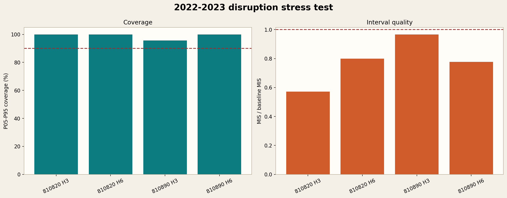
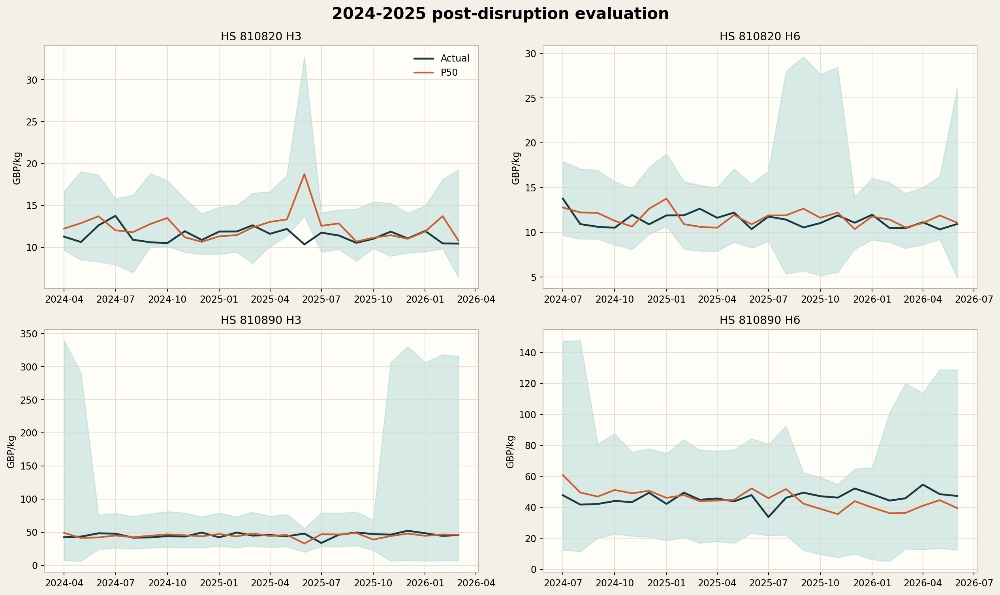
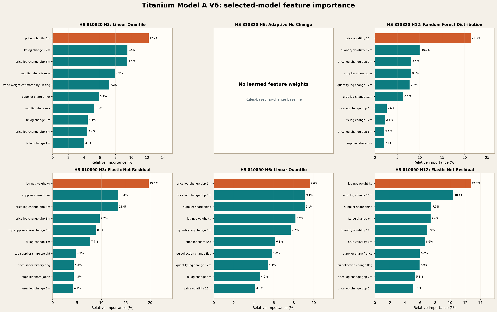

# Titanium Model A: Import-Price Forecasts

Updated 13 October 2026 from this package's saved training code, data, model selection and evaluation records. Documentation only: no retraining or model-selection changes.

## Summary And Current Readiness

Model A forecasts the **UK monthly titanium import unit value in GBP/kg**, separately for HS 810820 and 810890. It produces seven quantiles at **H3, H6 and H12**. H3/H6 are the principal acceptance horizons; H12 is reporting-only.

The saved V6 tables record **4/4 primary combinations passing the disruption gates and 3/4 passing post-disruption gates**. Median-price accuracy is mixed: a better uncertainty distribution does not always mean a more accurate central price. These are historical research results, not production approval.

**Important calibration-timing limitation:** validation includes origin months through January 2022 without restricting all their outcomes to information available before February 2022. For example, January 2022 H6 targets July 2022, and H12 targets January 2023. Nevertheless, build_validation_history() assigns every validation residual an availability date of 31 January 2022. Model selection and the starting calibration pool can therefore use outcomes unavailable at the stress-test start. The recorded passes are **not strictly point-in-time, leakage-free acceptance evidence**. This README exposes the issue; it does not fix or rerun the study.

## Data And Sources

| Item | What is used |
| --- | --- |
| Prepared training file | [titanium_model_a_production_v6_titanium_core_corrected_training.csv](data/titanium_model_a_production_v6_titanium_core_corrected_training.csv) |
| Coverage / frequency | January 2010-June 2026; monthly |
| Size | 396 rows, 134 columns; 198 months per HS code |
| Products | 810820: unwrought titanium and powders; 810890: other titanium articles, including bars, sheet and forgings |
| Excluded | HS 810830 waste and scrap |
| Trade | [UN Comtrade](https://comtradeplus.un.org/): UK import monetary values, net weight, suppliers and quality information |
| Currency | [Bank of England Database](https://www.bankofengland.co.uk/boeapps/database/): GBP-USD conversion and FX features |
| Inflation proxy | [ONS price statistics](https://www.ons.gov.uk/economy/inflationandpriceindices): ERUC/PPI broad non-ferrous import-price movements |
| Not used | USGS titanium sponge and World Bank aluminium/nickel benchmark features |

The CSV is a prepared snapshot, not the original raw downloads. It supports this package's fitting and inference; the complete raw-source collection/preparation archive is not inside V6. Historical absolute paths in manifests remain provenance, not runtime dependencies.

An import unit value is total import value divided by total net weight. For a USD-per-GBP exchange rate, **GBP/kg = USD/kg / USD_per_GBP**. This is not a titanium spot quote: product mix, processing, contract terms, supplier mix and low volumes affect unit values. HS 810820 and 810890 are different product categories, not identical titanium grades.

## Preparation, Features And Supervised Targets

Preparation aggregates trade monthly by HS, joins monthly FX/PPI, converts prices to GBP/kg, constructs historical changes and quality diagnostics, and aligns future observations as labels. Quality weights influence fitting. Some early lags and final future targets are naturally unavailable; eligibility filters control fitting, and future actuals are not invented.

There are **41 estimator inputs**, not 134. Exact names are recorded in [the model manifest](results/latest/model_manifest.json).

| Feature names / family | Meaning and usefulness |
| --- | --- |
| price_log_change_gbp_1m, _2m, _3m, _6m, _12m | Historical GBP/kg momentum and reversals |
| price_volatility_6m, price_volatility_12m | Historical variation in price movements |
| quantity_log_change_1m, _3m, _12m; quantity_volatility_6m, _12m | Volume movement and instability |
| log_net_weight_kg; volume_ratio_to_prior_12m_median; low_volume_history_flag | Shipment scale and unusually low/high volume; low weights can make prices unstable |
| supplier_share_usa, _japan, _france, _russia, _china, _other | Supplier/product-mix information |
| supplier_hhi_weight; top_supplier_share_weight; supplier_concentration_change_3m; top_supplier_share_change_3m; log_partner_count | Concentration, dominant suppliers and diversification |
| fx_log_change_1m, _3m, _6m, _12m; fx_volatility_6m | Exchange-rate movements affecting GBP prices |
| eruc_log_change_1m, _3m, _6m, _12m; eruc_volatility_6m | Broad non-ferrous import-price signal, not a titanium-specific benchmark |
| month_sin; month_cos | Cyclic calendar seasonality |
| price_shock_history_flag; world_weight_estimated_by_un_flag; eu_collection_change_flag | Observed-history/data-quality/collection-regime controls |

Feature names abbreviated with suffixes above share the displayed prefix. Dates, future target columns and availability controls are not estimator features. Derived inputs are calculations from the source history, not random synthetic observations. Feature importance shows statistical association, not causation.

The supervised regression target is **ln(price[t+h] / price[t])**. Convert output q to price with **price[t] * exp(q)**. This is the monthly price h months ahead, not the average of all intervening months. H6/H12 are direct fitted forecasts, not repeated H3 predictions.

| Horizon | Fitted target column | Corresponding actual price |
| --- | --- | --- |
| H3 | target_log_change_gbp_per_kg_h3 | target_unit_value_gbp_per_kg_h3 |
| H6 | target_log_change_gbp_per_kg_h6 | target_unit_value_gbp_per_kg_h6 |
| H12 | target_log_change_gbp_per_kg_h12 | target_unit_value_gbp_per_kg_h12 |

Target-month and assumed target-availability columns supply alignment. Retained USD labels are not the GBP target fitted in V6.

## Chronological Splits

This is an expanding-history study, not a random split. Each validation block fits eligible history at its first assumed availability cutoff. Test fits refresh monthly and may use earlier test outcomes after they become assumed available; the selected algorithm remains frozen.

| Stage | Forecast-origin months | Notes |
| --- | --- | --- |
| Initial history | 2010-2016 before the first validation block | Lag completeness, reliability and target availability reduce actual fit rows |
| Validation block 1 | January-December 2017 | Expanding history |
| Validation block 2 | January-December 2018 | Expanding history |
| Validation block 3 | January-December 2019 | Expanding history |
| Validation block 4 | February 2020-January 2021 | January 2020 is not in the configured blocks |
| Validation block 5 | February 2021-January 2022 | 60 forecasts per HS/horizon pooled for selection/calibration |
| Disruption stress | February 2022-December 2023 | 23 origins per HS/horizon; war-era stress window |
| Post-disruption | January 2024-December 2025 | 24 origins; additional reused historical evaluation |
| Latest saved forecast | June 2026 reference observation | Final bundles use eligible completed labels; actual future prices are unavailable in this snapshot |

Origin dates and target dates are different. Stress H3 targets run May 2022-March 2024, H6 August 2022-June 2024 and H12 February 2023-December 2024. Post H3/H6 targets end March/June 2026. Post H12 targets extend through December 2026, so only 18 of 24 outcomes are observed.

These are this V6 implementation's periods, not the earlier proposed generic split for all three models. Assumed release dates and current revised historical snapshots do not establish verified point-in-time availability.

## Algorithms And Saved Selection

| Candidate | Learning / uncertainty method |
| --- | --- |
| Linear quantile | Regularized, quality-weighted quantile regressions |
| Gradient Boosting quantiles | Nonlinear quantile-loss regressors |
| Random Forest distribution | Weighted tree ensemble; quantiles of individual-tree predictions |
| Elastic Net residual | Standardized regularized central regression plus residual quantiles |
| Huber residual | Robust central regression plus residual quantiles |
| Adaptive no-change | No learned feature-to-price mapping; no-change distribution with volatility scaling |
| Fixed no-change baseline | Separate benchmark distribution and calibration history |

The adaptive distribution scales around its median using current 6-month volatility relative to its training reference, with the implemented scale clipped to 0.80-1.80. Quantiles are non-crossing. Calibration expands P05/P95; rolling evaluation pools up to 36 available residuals and prefers the same volatility regime when sufficient history exists.

Selection minimizes calibrated validation MIS among gate-eligible candidates; raw pinball loss breaks ties. The same pooled validation residuals calibrate the validation intervals, so their coverage is not an independent calibration holdout.

| HS | H3 | H6 | H12 / reporting-only |
| --- | --- | --- | --- |
| 810820 | Linear quantile | Adaptive no-change | Random Forest distribution |
| 810890 | Elastic Net residual | Linear quantile | Elastic Net residual |

[810820 saved bundle](models/titanium_model_a_corrected_core_hs810820_selected_bundle.joblib) and [810890 saved bundle](models/titanium_model_a_corrected_core_hs810890_selected_bundle.joblib) each contain three fitted horizon entries, preprocessing and calibration metadata. They are not single multi-output estimators.

## Evaluation Metrics

| Metric | Meaning |
| --- | --- |
| MAE / RMSE | P50 absolute error / root mean squared error in GBP/kg; RMSE penalizes large misses more |
| MAPE / sMAPE | Mean percentage deviation / symmetric percentage deviation; neither is classification accuracy |
| Pinball loss | Average quantile loss over seven outputs; lower is better |
| P05-P95 coverage | Observed fraction within the nominal 90% interval; not guaranteed future coverage |
| Mean Interval Score (MIS) | Width plus miss penalties at alpha 0.10, here in log-change units |
| MIS / baseline | Below 1 means improved interval score versus the separately calibrated baseline |
| Recovery | Six-origin rolling coverage by August 2022 using eventual outcomes, not six outcomes already published then |

Recorded H3/H6 acceptance requires coverage >=90%, better MIS, complete outputs and that recovery check. H12 is outside the pass count. A baseline's false pass flag is expected because it cannot beat itself. Recovery here is not equivalent to Model C's completed-outcome recovery definition.

### Selected Validation Results

| HS / horizon | Coverage | MIS | MIS / baseline |
| --- | ---: | ---: | ---: |
| 810820 H3 | 93.33% | 0.8540 | 0.9701 |
| 810820 H6 | 93.33% | 0.9442 | 0.9780 |
| 810820 H12 | 93.33% | 0.8351 | 0.7739 |
| 810890 H3 | 93.33% | 2.2366 | 0.8692 |
| 810890 H6 | 93.33% | 2.1693 | 0.7962 |
| 810890 H12 | 93.33% | 2.3062 | 0.7998 |

[Full algorithm comparison](results/validation/pretest_validation_model_comparison.csv). Identical coverage arises from the same-size calibrated pools; it is not independent confirmation of six future success rates.

### Disruption And Post-Disruption Results

| Period | HS / horizon | Coverage | MIS | MIS / baseline | Pinball loss | Recorded gate |
| --- | --- | ---: | ---: | ---: | ---: | --- |
| Stress | 810820 H3 | 100.00% | 0.5912 | 0.5722 | 0.0287 | Pass |
| Stress | 810820 H6 | 100.00% | 0.8546 | 0.7991 | 0.0376 | Pass |
| Stress | 810890 H3 | 95.65% | 2.7357 | 0.9671 | 0.0673 | Pass |
| Stress | 810890 H6 | 100.00% | 2.0481 | 0.7769 | 0.0642 | Pass |
| Post | 810820 H3 | 95.83% | 0.8307 | 0.8275 | 0.0386 | Pass |
| Post | 810820 H6 | 100.00% | 0.8212 | 0.7395 | 0.0279 | Pass |
| Post | 810890 H3 | 100.00% | 1.8680 | 1.0371 | 0.0386 | Fail MIS |
| Post | 810890 H6 | 100.00% | 1.8069 | 0.8674 | 0.0515 | Pass |

[Stress metrics](results/stress_2022_2023/evaluation_metrics.csv) and [post metrics](results/post_2024_2025/evaluation_metrics.csv). Primary rows have all 23/24 outputs. Post H12 has 75% recorded coverage and infinite MIS because six unknown outcomes are counted as misses; it is incomplete outcome evidence, not proof those unknown forecasts were wrong.

### Median Errors Versus Baseline

Recalculated from saved prediction rows with positive observed actual prices and finite P50. MAE/RMSE are GBP/kg. Model MAPE is not the selection objective.

| Period | HS / horizon | MAE | RMSE | Model MAPE | Baseline MAPE | Model sMAPE |
| --- | --- | ---: | ---: | ---: | ---: | ---: |
| Stress | 810820 H3 | 0.8838 | 1.1217 | 8.12% | 10.32% | 8.43% |
| Stress | 810820 H6 | 1.3980 | 1.6942 | 12.26% | 12.26% | 13.20% |
| Stress | 810890 H3 | 7.6000 | 10.5162 | 20.02% | 19.85% | 16.88% |
| Stress | 810890 H6 | 8.2450 | 10.5279 | 20.75% | 18.53% | 17.99% |
| Post | 810820 H3 | 1.3313 | 2.1718 | 12.11% | 9.10% | 10.57% |
| Post | 810820 H6 | 0.9087 | 1.1097 | 8.06% | 8.06% | 7.87% |
| Post | 810890 H3 | 4.1186 | 5.5263 | 9.33% | 10.25% | 9.40% |
| Post | 810890 H6 | 6.5035 | 7.4881 | 14.28% | 7.93% | 14.45% |

[Stress actual/predicted records](results/stress_2022_2023/selected_and_baseline_predictions.csv) and [post records](results/post_2024_2025/selected_and_baseline_predictions.csv). Compare **actual_target_price_gbp_per_kg** with **p50_price_gbp_per_kg**. actual_origin_price_gbp_per_kg is the starting price, not ground truth for the future month. Signed error = P50 - actual; absolute percentage error = 100 * abs(P50 - actual) / actual.

810820 H3 improves stress median MAPE but not post MAPE. Adaptive H6 has the same median as baseline; its improvement is interval calibration. 810890 H6 has better interval scores but worse median MAPE than baseline. High coverage alone can reflect wide intervals; MIS penalizes width, and timing limitations still apply.

## Latest Saved Forecasts

Reference observation: **June 2026**, not the computer's current month. These are unseen target values relative to the prepared snapshot; a past calendar month is not automatically an observed actual in this dataset.

| HS | Horizon / target | P05 GBP/kg | P50 GBP/kg | P95 GBP/kg |
| --- | --- | ---: | ---: | ---: |
| 810820 | H3 / September 2026 | 8.3006 | 12.6599 | 15.7657 |
| 810820 | H6 / December 2026 | 8.6626 | 10.9202 | 14.4837 |
| 810820 | H12 / June 2027 | 8.4861 | 10.7770 | 13.1116 |
| 810890 | H3 / September 2026 | 31.2629 | 50.8343 | 82.2818 |
| 810890 | H6 / December 2026 | 29.2205 | 50.7638 | 83.9316 |
| 810890 | H12 / June 2027 | 25.5961 | 53.0612 | 103.1928 |

[Full forecast CSV](results/latest/latest_reference_forecasts.csv), [response JSON](results/latest/model_a_production_response.json), [manifest](results/latest/model_manifest.json). Outputs include seven quantiles, HS/product, horizon, origin/target month, selected model, currency/unit and research status.

810890's high P95 values describe large upper-tail uncertainty, not its expected central price. Quantiles must be ordered within a horizon, but P95 or P50 need not increase with horizon. Future accuracy requires actual outcomes.

## Graphs And Dashboards

[Post coverage/MIS](visualizations/post_2024_2025_coverage_and_mis.png) | [Reliability over time](visualizations/target_reliability_over_time.png) | [Performance dashboard](visualizations/titanium_model_a_v6_performance_dashboard.html) | [V6 dashboard](visualizations/titanium_model_a_production_v6_titanium_core_corrected_dashboard.html).

GitHub displays the PNGs. Download HTML pages and open them locally for interactive content; GitHub's file viewer does not run the dashboards.

## Folder Map And Reproduction

| Location | Contents |
| --- | --- |
| data/ | Package-local prepared training snapshot |
| code/ and code/engines/ | V6 training, local inference, engine dependencies, dashboard/PDF utilities |
| models/ | Two HS bundles with three horizons each |
| results/ | Validation, stress, post and latest records |
| visualizations/ | PNG/HTML reports |
| monitoring/ | Feature drift, historical forecasts and data-quality diagnostics |
| documentation/ | Model card and PDF records |

From this V6 directory: `python -m pip install -r requirements.txt`, then `python code/saved_model_inference.py`. Verification reproduces **42 latest quantile-price values**, without training. The combined root's VERIFY_PACKAGE.cmd checks all models and the UI.

RUN_TRAINING_V6.cmd retrains and writes artifacts. Do not run it merely to view saved results or overwrite the chosen evidence without preserving a copy/new run directory. Packaging changed local import paths only; saved models are unchanged. Load only trusted joblib files.

## Limitations And Next Work

This is a caveated research/demo package, not an unqualified production pricing model. Correct availability-purged selection/calibration, evaluate realistic completed-outcome recovery, obtain verified release dates/vintages, and validate on an untouched prospective holdout before production use. Earlier experiments inspected these historical periods. ERUC is a broad proxy and product-mix effects remain substantial.

Saved-value reproduction confirms implementation consistency, not future accuracy. A's MIS, B's Brier and C's index error are different measures and should not be numerically ranked against each other. Read the [data reuse review](../../DATA_SOURCES_AND_REUSE.md) before public redistribution. Pinned versions match the checked environment; clean-environment installation has not been tested.
